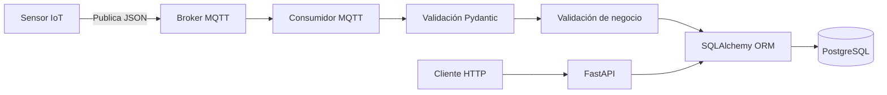

# Taller 2 — API para adquisición y consulta de datos IoT

**Asignatura:** Aplicaciones y Servicios Web — ITM  
**Programa:** Tecnología en Desarrollo de Software  
**Modalidad:** Individual  
**Sensor:** `WQ-003`  
**Tópico MQTT configurado inicialmente:** `iot/sensors/WQ-003/data`  
**Repositorio:** https://github.com/Gegaela1/AppsServicesWeb  
**Rama de entrega:** `taller-2`  
**Fecha de entrega indicada:** 10 de octubre de 2026

## 1. Descripción

El proyecto consiste en desarrollar una aplicación backend que reciba mensajes IoT mediante MQTT, valide los datos recibidos, consulte la configuración del sensor y sus magnitudes en PostgreSQL, almacene las mediciones válidas y permita consultar la información mediante endpoints HTTP de FastAPI.



## 2. Tecnologías

- Python 3.10 o superior.
- FastAPI y Uvicorn.
- Pydantic.
- SQLAlchemy ORM.
- PostgreSQL.
- Cliente MQTT para Python, conforme a las dependencias del proyecto.
- Git y GitHub.
- `pytest`, si se utiliza para las pruebas.

Las versiones y dependencias definitivas deben corresponder al archivo `requirements.txt` del repositorio.

## 3. Configuración del entorno

Desde PowerShell, en la raíz del proyecto:

```powershell
py -m venv .venv
.\.venv\Scripts\Activate.ps1
python -m pip install --upgrade pip
pip install -r requirements.txt
```

Crea `.env` a partir de `.env.example`. No publiques `.env` ni credenciales reales.

Variables MQTT de referencia:

```dotenv
MQTT_BROKER=emqx.coriotlab.co
MQTT_PORT=1883
MQTT_TOPIC=iot/sensors/WQ-003/data
MQTT_USERNAME=
MQTT_PASSWORD=
MQTT_KEEPALIVE=60
```

El tópico anterior se usa como configuración inicial para `WQ-003`, derivado del patrón descrito en la guía. Debe considerarse verificado solo después de comprobar la suscripción y observar mensajes reales. No inventes credenciales si el docente no las ha proporcionado.

Configura también las variables de PostgreSQL que utilice el código. Las credenciales deben residir únicamente en `.env` local, no en el código ni en este README.

Asegúrate de que `.gitignore` excluya como mínimo:

```gitignore
.venv/
__pycache__/
*.py[cod]
.env
.pytest_cache/
```

## 4. MQTT y payload

MQTT utiliza un modelo de publicación/suscripción: el sensor publica mensajes en un tópico y el consumidor se suscribe al broker para recibirlos.

- **Broker:** `emqx.coriotlab.co`
- **Puerto:** `1883`
- **Sensor:** `WQ-003`
- **Tópico inicial:** `iot/sensors/WQ-003/data`

Ejemplo ilustrativo de la estructura de payload descrita en la guía (no es un mensaje real de WQ-003 salvo que se haya recibido y verificado):

```json
{
  "sensor_id": "TEST-001",
  "timestamp": "2026-10-07T16:25:30Z",
  "measurements": {
    "temperature": {
      "value": 24.6,
      "unit": "C"
    }
  }
}
```

El campo `sensor_id` corresponde al campo `codigo` de la tabla `sensores`, no a su clave primaria numérica `id`.

Completa después de la comprobación real:

- **Recepción real comprobada:** Pendiente.
- **Fecha/hora de prueba:** Pendiente.
- **Magnitudes observadas:** Pendiente.
- **Unidades observadas:** Pendiente.
- **Payload real anonimizado, si procede:** Pendiente.

## 5. Modelo de datos y reglas de persistencia

La fuente oficial del modelo es `data-model.md`. La implementación debe respetar los nombres, tipos, claves, restricciones e índices definidos allí.

### `sensores`

Catálogo de sensores, con código, nombre, categoría, ubicación, estado y fecha de registro.

### `sensor_magnitudes`

Relaciona los sensores con las magnitudes que pueden medir e incluye unidad y límites permitidos.

### `mediciones`

Almacena el valor medido, la referencia a `sensor_magnitudes`, el timestamp de medición en UTC y la fecha de recepción.

El catálogo de sensores y magnitudes ya existe en la base compartida. La aplicación puede consultarlo, pero no crear, modificar ni eliminar esos registros. No ejecutes `create_all()`, migraciones ni modificaciones del esquema sobre la base compartida sin autorización del docente.

Reglas de negocio:

1. Validar JSON, campos obligatorios y tipos.
2. Validar el timestamp y preservar el instante UTC.
3. Comprobar que el sensor exista y esté activo.
4. Comprobar que la magnitud esté asociada al sensor.
5. Verificar unidad y rango según el catálogo y las reglas de la guía.
6. Si un payload contiene varias magnitudes y alguna es inválida, rechazar el payload completo.
7. Guardar las mediciones del mismo payload en una sola transacción, evitando persistencia parcial.
8. Mantener separados el timestamp de medición y la fecha de recepción.

No redondees ni alteres silenciosamente valores inválidos para forzarlos a entrar en la base de datos.

## 6. Organización del código

Estructura mínima de referencia de la guía:

```text
app/
├── main.py
├── schemas/
│   ├── sensor.py
│   ├── sensor_magnitud.py
│   └── medicion.py
├── models/
│   ├── sensor.py
│   ├── sensor_magnitud.py
│   └── medicion.py
├── crud/
│   ├── sensor.py
│   ├── sensor_magnitud.py
│   └── medicion.py
├── api/
│   ├── sensor.py
│   ├── sensor_magnitud.py
│   └── medicion.py
├── mqtt/
│   └── client.py
└── database/
    └── connection.py
```

Ajusta este esquema al árbol real de archivos. No declares que un módulo existe si todavía no se ha creado.

- `schemas/`: contratos y validación Pydantic.
- `models/`: modelos ORM.
- `crud/`: operaciones de acceso a datos.
- `api/`: endpoints HTTP.
- `mqtt/`: conexión, suscripción y procesamiento de mensajes.
- `database/`: conexión y sesiones de PostgreSQL.
- `main.py`: creación de FastAPI e inclusión de routers.

## 7. Endpoints

Confirma las rutas exactas en la guía y en el código. La guía enumera, como mínimo:

| Método | Ruta | Propósito |
|---|---|---|
| GET | `/sensores` | Consultar sensores |
| GET | `/sensores/{id}` | Consultar sensor por ID |
| GET | `/sensores/por-codigo/{codigo}` | Consultar sensor por código |
| GET | `/sensores/{id}/magnitudes` | Consultar magnitudes de un sensor |
| GET | `/sensor-magnitudes/{id}` | Consultar una relación sensor-magnitud |
| GET | `/mediciones/{id}` | Consultar medición por ID |
| GET | `/sensores/{id}/mediciones` | Consultar mediciones históricas |
| GET | `/sensores/{id}/ultima-medicion` | Consultar última medición |

La consulta histórica debe admitir los filtros establecidos en la guía: magnitud, fecha inicial, fecha final y límite de resultados. Deben funcionar individualmente y combinados.

Ejemplos (sustituye los valores por datos válidos):

```text
GET /sensores/{id}/mediciones?desde=2026-10-01T00:00:00Z&hasta=2026-10-10T23:59:59Z
GET /sensores/{id}/mediciones?magnitud=temperature
GET /sensores/{id}/mediciones?limit=10
GET /sensores/{id}/mediciones?magnitud=temperature&desde=2026-10-01T00:00:00Z&hasta=2026-10-10T23:59:59Z&limit=10
```

`limit` debe validarse y las últimas N mediciones deben devolverse en un orden determinista. La última medición debe seleccionarse por el timestamp de medición, con un criterio consistente para empates.

### Códigos HTTP requeridos

- `200`: consulta correcta.
- `400`: rango de fechas inválido, por ejemplo, `desde > hasta`.
- `404`: recurso inexistente.
- `422`: parámetros o datos HTTP que no superan la validación.

No devuelvas un objeto de error con HTTP 200 cuando la operación haya fallado. Los errores MQTT se documentan en los logs del consumidor; no son respuestas HTTP.

## 8. Fechas

Los timestamps de medición deben preservar el instante UTC. En las respuestas GET, convierte las fechas a la zona horaria `America/Bogota`, conforme a la guía.

Distingue entre:

- `timestamp_utc`: instante de la medición.
- `fecha_recepcion`: instante en que la aplicación recibió el mensaje.

Comprueba que los filtros de fecha y la conversión de zona horaria no alteren el instante representado.

## 9. Ejecución de la aplicación

Si el punto de entrada real está en `app/main.py`, inicia FastAPI desde la raíz del proyecto:

```powershell
uvicorn app.main:app --reload
```

Si el archivo está en otra ubicación, adapta el módulo de importación a la estructura real.

Con el servidor ejecutándose, la documentación interactiva suele estar disponible en:

`http://127.0.0.1:8000/docs`

No afirmes que la URL funciona si el servidor no está activo. Documenta también el comando real para iniciar el consumidor MQTT si se ejecuta como proceso separado.

## 10. Pruebas y evidencias

Registra resultados observados. Toda prueba que no se haya ejecutado debe permanecer como **Pendiente**.

| ID | Prueba | Resultado esperado | Estado inicial |
|---|---|---|---|
| T01 | Recepción MQTT | Se observa un mensaje real del tópico | Pendiente |
| T02 | Medición válida | Registro comprobado en PostgreSQL | Pendiente |
| T03 | Sensor inexistente | Payload rechazado, sin persistencia | Pendiente |
| T04 | Unidad incorrecta | Payload rechazado, sin persistencia | Pendiente |
| T05 | Tipo de dato incorrecto | Payload rechazado, sin persistencia | Pendiente |
| T06 | Magnitud incorrecta/no asociada | Payload rechazado, sin persistencia | Pendiente |
| T07 | Timestamp inválido | Payload rechazado | Pendiente |
| T08 | Consulta existente | Respuesta correcta | Pendiente |
| T09 | Consulta inexistente | HTTP 404 | Pendiente |
| T10 | Consulta histórica | Resultados correctos | Pendiente |
| T11 | Filtro de fechas | Solo resultados del intervalo | Pendiente |
| T12 | `desde > hasta` | HTTP 400 | Pendiente |
| T13 | Parámetro HTTP inválido | HTTP 422 cuando corresponda | Pendiente |
| T14 | Última medición | Registro más reciente | Pendiente |
| T15 | Últimas N mediciones | Se respeta `limit` y orden | Pendiente |
| T16 | Filtro por magnitud | Resultados filtrados | Pendiente |
| T17 | Atomicidad | Sin persistencia parcial | Pendiente |
| T18 | Conversión horaria | Hora local correcta, mismo instante | Pendiente |

Añade pruebas para sensor inactivo, límites de rango, JSON malformado, fallo de transacción, filtros combinados y claves foráneas.

Guarda las evidencias auténticas en `evidencias/`, organizadas, por ejemplo, en `mqtt/`, `api/`, `postgres/` y `pruebas/`. No incluyas secretos ni capturas de código fuente, ya que la guía indica que estas últimas no son necesarias.

### Recolección de datos

La guía exige recolectar datos durante al menos 20 minutos. Documenta hora de inicio y fin, duración real, mensajes recibidos, mediciones almacenadas, rechazos y evidencias. No marques este requisito como cumplido hasta haber realizado la recolección.

## 11. GitHub y entrega

Repositorio: https://github.com/Gegaela1/AppsServicesWeb  
Rama: `taller-2`

La rama debe contener el trabajo del Taller 2 sin ejercicios anteriores. Antes de crearla o cambiarla, inspecciona el estado del repositorio y conserva el trabajo previo. No ejecutes comandos destructivos sin revisar sus efectos.

Lista de verificación:

- [ ] Rama activa `taller-2`.
- [ ] No contiene ejercicios anteriores.
- [ ] Código fuente completo.
- [ ] `README.md`, `requirements.txt` y `.gitignore`.
- [ ] `.env.example` sin credenciales reales.
- [ ] `data-model.md`.
- [ ] Carpeta `evidencias/`.
- [ ] Ningún `.env` ni secreto publicado.
- [ ] Commits descriptivos.
- [ ] Enlace del repositorio accesible.

Como el trabajo es individual, no incluyas una tabla de aportes de integrantes de un equipo. Documenta tu autoría y el historial de commits.

## 12. Conclusiones

Completa esta sección al terminar, con base en los resultados reales:

- Funcionalidades implementadas.
- Pruebas ejecutadas y aprobadas.
- Dificultades encontradas y soluciones aplicadas.
- Requisitos pendientes y motivo.
- Aprendizajes sobre FastAPI, Pydantic, SQLAlchemy, PostgreSQL y MQTT.

## 13. Referencias

- FastAPI: https://fastapi.tiangolo.com/
- Pydantic: https://docs.pydantic.dev/
- SQLAlchemy: https://docs.sqlalchemy.org/
- PostgreSQL: https://www.postgresql.org/docs/
- Python: https://docs.python.org/3/
- MQTT: https://mqtt.org/
- Pro Git: https://git-scm.com/book/en/v2

---

**Integridad académica:** este documento debe describir la implementación real. Actualiza los estados, las rutas de evidencia, las magnitudes y los resultados después de verificarlos. No presentes ejemplos ilustrativos como datos reales.
